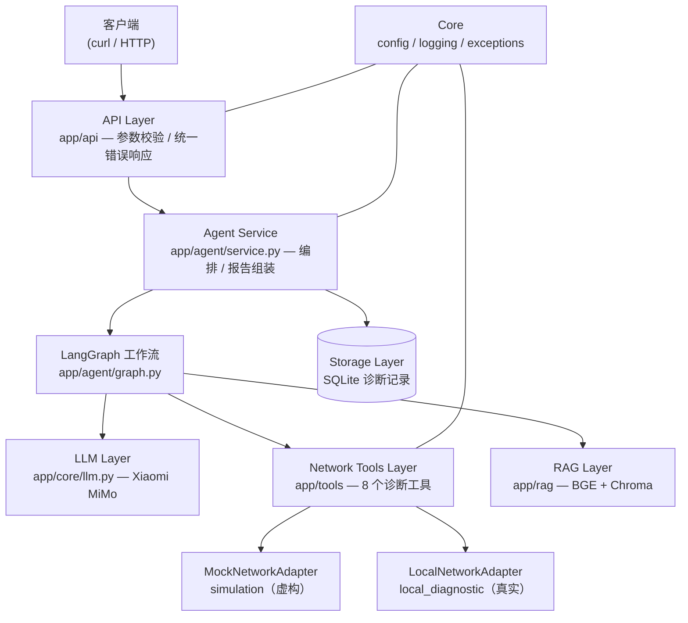
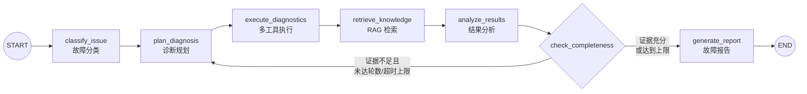
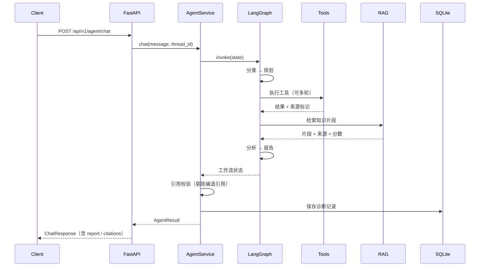
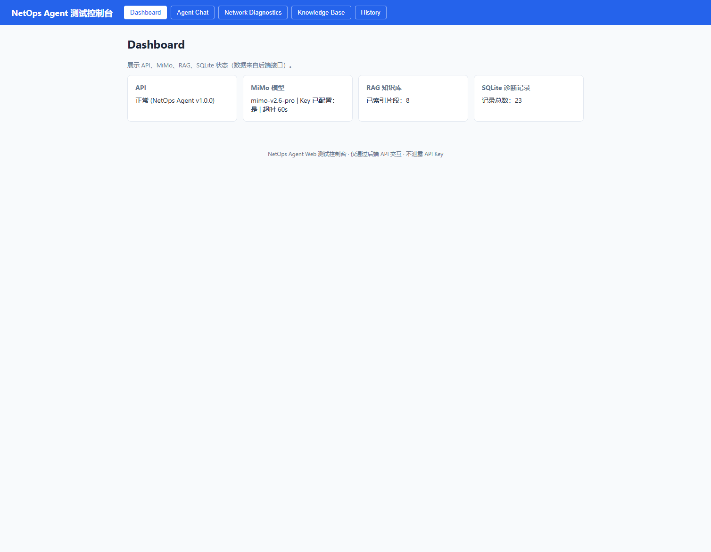
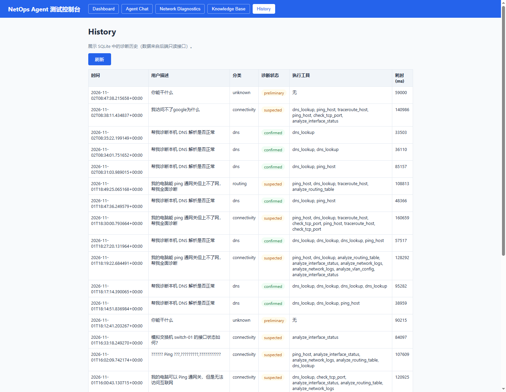

# NetOps Agent

**AI Network Operations & Troubleshooting Agent**

[](CHANGELOG.md)
[](https://www.python.org/)
[](LICENSE)
[](CHANGELOG.md)
[](https://langchain-ai.github.io/langgraph/)
[](https://fastapi.tiangolo.com/)
[](#测试)
[](#测试)
[](CHANGELOG.md)

基于 Xiaomi MiMo + LangGraph + FastAPI 的智能网络运维与故障诊断 Agent。

> 项目定位：AI Agent 技术学习、GitHub 开源展示、AI Agent 工程师求职作品集。
> **真实性要求**：只描述已实现并验证的功能；模拟数据明确标记为 `simulation`；未验证结论不标 `confirmed`。

## 系统架构

### 分层架构



### 诊断工作流



### 一次诊断请求的时序



详细模块职责、安全设计与真实性机制见 [docs/architecture.md](docs/architecture.md)。

## 演示案例

三个真实运行的演示案例（含真实输出捕获）见 [docs/demo_cases.md](docs/demo_cases.md)：

1. **本机连通性与 DNS 检测**——`local_diagnostic` 来源实证。
2. **模拟交换机状态分析**——`simulation` 来源标记演示。
3. **综合故障诊断**——多工具 + 知识引用校验 + 故障报告。

复现：

```bash
python scripts/run_demo.py          # 运行全部案例
python scripts/run_demo.py 1        # 只运行案例 1
python scripts/run_demo.py --save   # 同时保存响应 JSON 到 docs/demos/
```

## 环境要求

- Python 3.13.9
- Xiaomi MiMo API Key

## 安装

```bash
python -m venv .venv
source .venv/Scripts/activate        # Windows Git Bash
# Windows CMD: .venv\Scripts\activate.bat
pip install -e ".[dev]"
# 或按已验证版本安装
pip install -r requirements.txt
```

**两个依赖文件的分工**：
- `pyproject.toml` 列出**直接依赖**（9 个运行时 + 3 个开发），供 `pip install -e .` 使用，用于声明项目依赖边界。
- `requirements.txt` 是**完整环境锁定**（118 个包，含所有传递依赖），来自 `pip freeze`，供 `pip install -r` 一键复现已验证环境。

两者并不矛盾：前者是"需要什么"，后者是"装了什么"。升级依赖时，先改 `pyproject.toml`，再重新生成 `requirements.txt`。

## 配置

```bash
cp .env.example .env
```

编辑 `.env`，填入真实 API Key：

| 变量 | 说明 | 默认值 |
|---|---|---|
| `MIMO_API_KEY` | 必填，不入库 | （空） |
| `MIMO_BASE_URL` | Token Plan 专属地址 | `https://token-plan-cn.xiaomimimo.com/v1` |
| `MIMO_MODEL` | 模型型号（最终报告） | `mimo-v2.6-pro` |
| `MIMO_FAST_MODEL` | 快速模型（分类/规划/分析节点） | `mimo-v2.6-flash` |
| `MIMO_TIMEOUT` | 单次模型请求超时（秒） | `60` |
| `AGENT_MAX_STEPS` | 工具调用最大步数 | `3` |
| `AGENT_TIMEOUT` | Agent 任务总超时（秒） | `120` |
| `DIAG_ALLOW_ALL_TARGETS` | 允许任意 IP 目标（跳过白名单） | `true` |
| `DIAG_ALLOWED_TARGETS` | 诊断目标白名单（逗号分隔，仅当 `DIAG_ALLOW_ALL_TARGETS=false` 时生效） | `localhost,127.0.0.1,::1` |
| `DIAG_TIMEOUT` | 单个诊断工具超时（秒） | `10` |
| `RAG_KB_DIR` | 知识库文档目录 | `data/knowledge_base` |
| `RAG_PERSIST_DIR` | Chroma 持久化目录 | `data/chroma_db` |
| `RAG_EMBEDDING_MODEL` | Embedding 模型 | `BAAI/bge-small-zh-v1.5` |
| `RAG_TOP_K` | 检索返回片段数 | `4` |
| `RAG_CHUNK_SIZE` | 切分片段大小（字符） | `500` |
| `RAG_CHUNK_OVERLAP` | 切分重叠（字符） | `50` |
| `STORAGE_DB_PATH` | 诊断记录 SQLite 路径 | `data/netops.db` |

安全说明：

- **⚠️ 当前默认放开诊断目标白名单**（`DIAG_ALLOW_ALL_TARGETS=true`），可对任意 IP 执行 Ping / DNS / Traceroute / TCP 端口检测。仅限**受控测试环境**使用；请勿对未授权的网络、主机或设备执行扫描（未经授权的网络扫描在多数地区属违法行为）。如需恢复白名单防护，设置 `DIAG_ALLOW_ALL_TARGETS=false` 并配置 `DIAG_ALLOWED_TARGETS`。
- 所有命令使用固定参数列表，不拼接 Shell（`shell=False`）。
- 备用模型：`mimo-v2.6-flash`。
- 按量付费 Base URL 为 `https://api.xiaomimimo.com/v1`；使用 Token Plan 时以控制台提供的专属 Base URL 和 Key 为准。

**Embedding 模型下载说明**：首次索引知识库时 fastembed 会从 HuggingFace 下载
BGE 模型（约 100MB）。若所在网络无法访问 HuggingFace，可设置国内镜像：

```bash
export HF_ENDPOINT=https://hf-mirror.com   # Linux / Git Bash
# Windows CMD: set HF_ENDPOINT=https://hf-mirror.com
```

## 运行

```bash
uvicorn app.main:app --reload
```

服务默认监听 `http://127.0.0.1:8000`。

## API

| 方法 | 路径 | 作用 |
|---|---|---|
| GET | `/health` | 服务健康检查 |
| GET | `/api/v1/agent/providers` | 查询当前模型配置状态（不含密钥） |
| POST | `/api/v1/agent/chat` | 与 Agent 对话 |
| POST | `/api/v1/agent/chat/stream` | 与 Agent 对话（SSE 流式进度） |

**性能设计**：分类/规划/分析等迭代节点使用 `mimo-v2.6-flash`（快），
最终报告使用 `mimo-v2.6-pro`（质量优先）。SSE 流式按工作流节点推送进度
（`event: node|result|error`），改善过程可见性，总耗时与同步接口相同。

### 对话示例

```bash
curl -X POST http://127.0.0.1:8000/api/v1/agent/chat \
  -H "Content-Type: application/json" \
  -d "{\"message\": \"帮我诊断 switch-01 的接口状态\", \"thread_id\": \"demo-001\"}"
```

响应示例：

```json
{
  "success": true,
  "thread_id": "demo-001",
  "diagnosis_id": "8b704ebb607749c7",
  "answer": "本地 DNS 解析正常，可排除 DNS 故障 [引用2]……",
  "diagnosis_status": "suspected",
  "executed_tools": ["dns_lookup", "analyze_routing_table"],
  "tool_results": [
    {
      "tool_name": "dns_lookup",
      "args": {"hostname": "www.baidu.com"},
      "source": "local_diagnostic",
      "success": true,
      "summary": "解析到 2 个地址",
      "error": null
    }
  ],
  "next_steps": ["检查出口 NAT 配置……"],
  "citations": [
    {
      "marker": "[引用2]",
      "source": "network_connectivity.md",
      "snippet": "能 Ping 通网关但无法上网，最常见原因是 DNS 解析故障……",
      "score": 0.87,
      "verified": true
    }
  ],
  "report": {
    "issue_category": "connectivity",
    "summary": "综合判断……",
    "possible_causes": [
      {"cause": "……", "status": "suspected", "evidence": "dns_lookup[local_diagnostic]", "source_types": ["local_diagnostic", "simulation"]}
    ],
    "unverified_points": ["结论尚未被工具检测充分验证，标记为推测"],
    "tool_evidence": [],
    "knowledge_citations": [],
    "recommendations": ["……"]
  }
}
```

### 诊断工具

| 工具 | 来源 | 说明 |
|---|---|---|
| `ping_host` | local_diagnostic | Ping 连通性检测 |
| `dns_lookup` | local_diagnostic | DNS 解析查询 |
| `traceroute_host` | local_diagnostic | 路径追踪 |
| `check_tcp_port` | local_diagnostic | TCP 端口检测 |
| `analyze_interface_status` | simulation | 模拟设备接口状态 |
| `analyze_routing_table` | simulation | 模拟设备路由表 |
| `analyze_vlan_config` | simulation | 模拟交换机 VLAN 配置 |
| `analyze_network_logs` | simulation | 模拟设备运行日志 |

模拟设备（虚构数据）：`switch-01`（SW-CORE-01）、`router-01`（RTR-EDGE-01）、`firewall-01`（FW-EDGE-01）。

### 诊断状态

| 状态 | 含义 |
|---|---|
| `preliminary` | 仅根据用户描述初步分析，尚未执行验证工具 |
| `suspected` | 有一定工具证据的疑似原因，尚未充分验证 |
| `confirmed` | 有实际工具检测结果或可靠证据支持的结论 |
| `failed` | 诊断工具或流程执行失败，无法得出结论 |

## RAG 知识库

知识库文档放在 `data/knowledge_base/`（支持 PDF / TXT / Markdown），
启动服务后索引：

```python
from app.rag.service import RagService
RagService().index_knowledge_base()
```

API 响应中的 `citations` 字段给出回答引用的知识片段，每条包含：

- `marker`：回答中的引用标记（如 `[引用1]`）。
- `source`：知识文档文件名。
- `snippet`：检索到的片段原文。
- `score`：相似度分数。
- `verified`：是否与真实检索片段比对通过。

**引用真实性保障**：模型输出中的 `[引用N]` 会与本次真实检索片段逐条比对，
编号越界（编造）的引用会被剔除，不允许出现在最终回答中。
回答中严格区分工具检测结果、知识库内容与模型推断三类信息。

示例知识文档（虚构/通用运维知识）：DNS 故障排查、网络连通性排查、路由基础、交换机与 VLAN。

## 测试

```bash
# 离线测试（默认，不需要 API Key）
pytest -m "not real_api"

# 离线测试 + 覆盖率统计
pytest -m "not real_api" --cov --cov-report=term-missing

# 真实 MiMo API 测试（需要 MIMO_API_KEY，含 Function Calling 兼容性）
pytest -m real_api
```

当前离线测试 149 个，行+分支覆盖率 89%（149 passed / 158 collected / 9 真实 API 用例需 `MIMO_API_KEY`）。

## 代码检查

```bash
ruff check .
```

## API 文档

服务启动后可访问交互式文档：

| 地址 | 说明 |
|---|---|
| `/` | **Web 测试控制台** |
| `/docs` | Swagger UI（可直接在线调试） |
| `/redoc` | ReDoc 文档 |
| `/openapi.json` | OpenAPI schema（可导入 Postman 等工具） |

文档包含接口分组标签、请求示例与响应模型说明。

## Web 测试控制台

启动服务后浏览器打开 `http://127.0.0.1:8000/` 即可使用。

### 页面截图

| Dashboard | Agent Chat |
|---|---|
|  |  |

| Network Diagnostics | Knowledge Base | History |
|---|---|---|
|  |  |  |

### 辅助接口

| 接口 | 作用 |
|---|---|
| `GET /api/v1/diagnostics/tools` | 诊断工具列表（含参数定义） |
| `POST /api/v1/diagnostics/run` | 执行单个诊断工具 |
| `GET /api/v1/knowledge/status` | 知识库索引状态 |
| `POST /api/v1/knowledge/search` | 知识检索 |
| `GET /api/v1/history` | 诊断历史查询 |

以上接口均为只读/诊断性质，复用现有 Service，不重复实现业务逻辑。

## 项目结构

```text
NetOps-Agent/
├── app/
│   ├── main.py              # FastAPI 入口
│   ├── api/
│   │   ├── routes/          # 路由
│   │   └── schemas/         # 请求/响应模型
│   ├── core/
│   │   ├── config.py        # 配置管理
│   │   ├── llm.py           # MiMo 模型创建
│   │   ├── logging.py       # 日志配置
│   │   └── exceptions.py    # 领域异常
│   ├── agent/
│   │   ├── state.py         # LangGraph 状态
│   │   ├── prompts.py       # 提示词
│   │   ├── nodes.py         # 工作流节点
│   │   ├── routing.py       # 条件路由
│   │   ├── graph.py         # 工作流构建
│   │   └── service.py       # Agent 服务
│   ├── tools/
│   │   ├── network_tools.py # 8 个诊断工具
│   │   └── registry.py      # 工具注册表
│   ├── network/
│   │   ├── base.py          # 数据模型（含来源标记）
│   │   ├── validation.py    # 参数与白名单校验
│   │   ├── mock_adapter.py  # 模拟设备适配器
│   │   └── local_adapter.py # 本机诊断适配器
│   ├── rag/
│   │   ├── models.py        # 文档/片段/引用模型
│   │   ├── loaders.py       # PDF/TXT/Markdown 加载
│   │   ├── splitter.py      # 文本切分
│   │   ├── embeddings.py    # BGE Embedding（fastembed）
│   │   ├── store.py         # Chroma 向量库
│   │   └── service.py       # RAG 服务 + 引用校验
│   └── models/
│       └── diagnosis.py     # 诊断状态模型
├── data/
│   ├── simulated_devices/   # 虚构设备配置
│   ├── sample_logs/         # 虚构设备日志
│   └── knowledge_base/      # 知识库文档
├── tests/
│   ├── unit/
│   └── integration/
├── .env.example
├── pyproject.toml
├── requirements.txt
└── README.md
```

## MiMo Function Calling 兼容性

Phase 2 已用真实接口验证 Xiaomi MiMo 与 LangChain/LangGraph 的工具调用兼容性：

| 验证项 | 结果 |
|---|---|
| 普通对话 | ✅ |
| 单次工具调用 | ✅ |
| 工具参数解析与校验 | ✅ |
| 工具执行结果写回 Agent State | ✅ |
| 多轮工具调用 | ✅ |
| 工具执行失败与异常恢复 | ✅ |
| 思考模式多轮工具调用 | ✅（见下方已知限制） |

**已知限制**：MiMo 响应中的 `reasoning_content` 字段（思考内容）经 `langchain-openai`
适配器后不会保留在 `additional_kwargs` 中。经真实接口验证，该字段不是多轮工具调用
续传的必要条件，多轮工具调用本身完全正常。如需完整获取思考内容，可直接使用 OpenAI SDK
读取原始响应字段。

## 诚实性说明

- 本项目只描述已实现并验证的功能。
- 模拟设备数据明确标记为 `simulation`，是虚构数据，不代表真实设备状态。
- 本机检测明确标记为 `local_diagnostic`，执行真实网络检测（当前默认放开目标白名单，见安全说明）。
- 未经工具验证的结论不会标记为 `confirmed`。
- 工具执行失败时如实返回错误，不伪装成正常诊断结果。
- 知识库引用必须对应真实检索片段，编造引用会被剔除。
- 回答中区分工具检测结果、知识库内容与模型推断三类信息。
